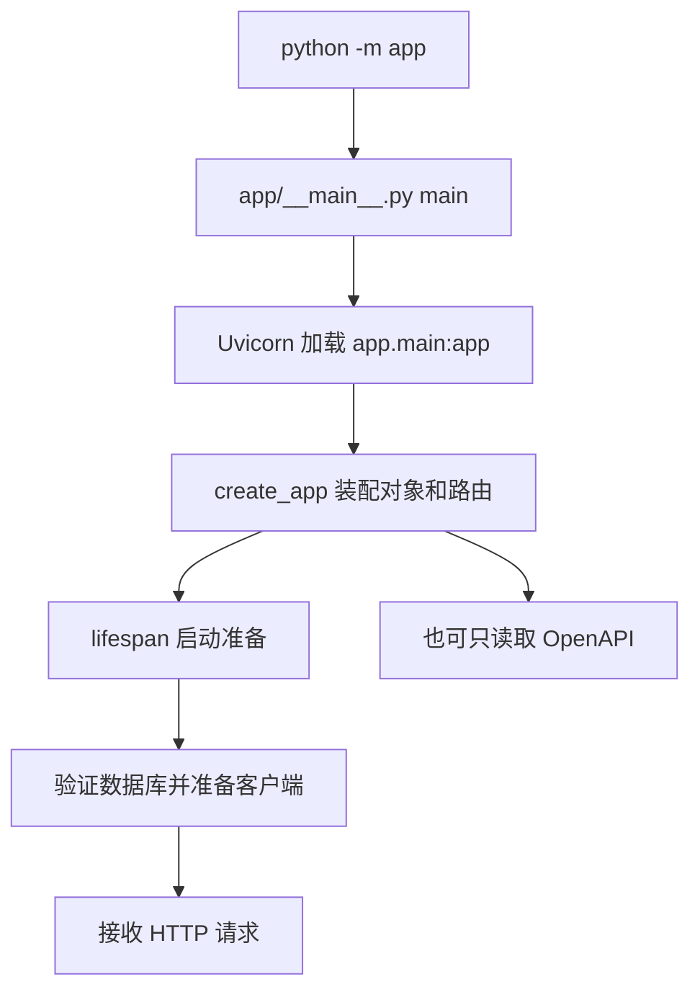

# RAG 中台 Day01 项目边界工程入口与契约验证

第一阶段 Day01　对应 U01　编写日期 2026-10-25

你接手的是一个已经实现的后端项目。今天从现有源码出发，回答三个问题：它向业务方提供什么，Python 从哪里进入应用，怎样用证据确认工程确实只提供约定的三个业务操作。学完后应能独立画出项目地图、拼出接口路径，并解释一次测试通过究竟证明了什么。

今天不要求 PostgreSQL、Docker Engine 或模型密钥。我们会创建 FastAPI 对象、读取 OpenAPI、执行进程内 HTTP 契约测试，明确保留真实服务启动与数据库、模型集成的验收边界。代码已经存在不代表你已经掌握，运行成功也不能替代自己的解释与复刻。

学习周期和各 Day 的范围以[学习路线总纲](../../交接文档及学习路线/RAG中台_学习路线总纲.md)为准。今天结束后，将自己的解释、实验和错因记入 [Day01 学习记录](Day01_学习记录模板.md)，不要直接把教材答案复制成学习结论。

## 1 先建立一个具体的问题

假设业务方有一份退款规则：“订单完成后七天内可以申请退款。” 用户问：“退款申请期限是多少？” 业务方希望自己的应用能找到这条规则，并用自己选定的大模型组织回答。

当前中台承担其中的资料索引和检索。调用方先创建知识库，再提交文本；中台将文本切片、生成向量并写入数据库。收到问题后，中台生成 query 向量，检索相关 chunk，返回原文片段、来源 ID、分数和元数据。它没有在本阶段调用生成模型输出最终答案。


图中的最后一步是调用方后续可以实现的行为，不是当前工程已经完成的功能。这个区别会影响你后面每一次演示、测试和面试描述。

如果今天把它叫作“已经能自动回答企业所有问题的 Agent”，至少越过了两个事实：项目尚未生成答案，也没有规划、工具选择与执行反馈循环。更准确的介绍是：“这是一个面向业务系统的 RAG 检索服务，一期提供知识库创建、同步索引和结构化召回。”

## 2 今天的目标和时间分配

建议投入约 160 分钟；如果 Python 基础不熟，可以拆成两次学习，第二次先回顾自己画的图。

| 环节 | 建议时间 | 学完后留下什么 |
| --- | --- | --- |
| 业务边界与术语 | 15 分钟 | 一张业务方与中台分工图 |
| 工程目录与解释器 | 20 分钟 | 项目路径、Python 路径、依赖来源 |
| 启动入口和应用工厂 | 35 分钟 | 从 python -m app 到 lifespan 的顺序图 |
| 三个路由和测试夹具 | 25 分钟 | 三个完整路径及契约测试边界 |
| 实验、测试与失败复现 | 40 分钟 | 正常输出、三种可控失败及测试结果 |
| 闭卷复刻和口述 | 25 分钟 | 自己的集合比较函数和两分钟解释 |

今天只需要掌握以下五个结论：

1. 中台接收什么、返回什么，哪些能力由调用方负责。
2. Python 包、模块、启动函数和 FastAPI 对象的区别。
3. 三个业务路径如何由多层路由前缀组成。
4. 为什么今天可以不连数据库检查契约，但不能据此宣布部署成功。
5. 怎样发现缺失、错误方法和额外业务操作，并指出具体差异。

Pydantic 校验细节安排在 Day03，依赖注入和生命周期细节安排在 Day04，数据库事务安排在第二阶段。今天遇到它们时先认识职责，不要求一次掌握全部原理。

## 3 今天要打开的真实资产

下列链接都指向当前工程；先按顺序读，不必把整个仓库从头翻到尾。

| 资产 | 今天关注的位置 | 要回答的问题 |
| --- | --- | --- |
| [pyproject.toml](../../../pyproject.toml) | requires-python、dependencies、pytest 配置 | 应该用哪个 Python，默认测试从哪里收集 |
| [uv.lock](../../../uv.lock) | fastapi、uvicorn 等包的锁定版本 | 依赖范围和确定版本是否是一回事 |
| [app/__main__.py](../../../app/__main__.py) | main、模块入口保护 | python -m app 如何开始执行 |
| [app/main.py](../../../app/main.py) | create_app、lifespan、app | 创建对象与真实启动有什么区别 |
| [总路由](../../../app/api/v1/router.py) | prefix 与 include_router | /api/v1 如何加到路径前面 |
| [知识库路由](../../../app/api/v1/routes/knowledge_bases.py) | router 和 create_knowledge_base | 请求交给了谁 |
| [文档路由](../../../app/api/v1/routes/documents.py) | upload_document | 上传接口为什么没有直接写切片代码 |
| [检索路由](../../../app/api/v1/routes/rag.py) | retrieve | 问题检索从哪里进入 Service |
| [接口契约测试](../../../tests/test_api_contract.py) | client fixture 和两个路由测试 | 怎样不启动数据库测试 HTTP 契约 |
| [配置测试](../../../tests/test_config.py) | 六组非法配置 | 为什么配置校验不等于连接外部服务 |
| [Day01 路由探针](Day01_实验/route_probe.py) | 收集与比较操作集合 | 怎么指出实际契约与预期的具体差异 |
| [Day01 实验测试](Day01_实验/test_day01_contract.py) | 正常、变异和 HTTP 测试 | 断言怎样覆盖正确与失败路径 |

生产路由、应用工厂和入口是真实项目实现。Day01_实验下的文件是新增加的教学资产，不参与生产服务启动，也没有增加业务接口。

## 4 确认自己位于正确工程

先在 PowerShell 中进入项目根目录：

```powershell
Set-Location -LiteralPath 'C:\path\to\rag-center'
Get-Location
git rev-parse --show-toplevel
git status --short
```

项目根应当是 rag-center。不要凭终端标题猜测当前目录，也不要把上层 ai 下的其他工程混入本次操作。工作区可能存在本次教材或用户自己的修改，status 非空不代表你应该删除或重置它们。

接着确认项目虚拟环境的解释器：

```powershell
& '.\.venv\Scripts\python.exe' --version
& '.\.venv\Scripts\python.exe' -c 'import sys; print(sys.executable)'
```

项目要求 Python 3.11。使用完整的项目解释器路径，可以避免全局 python 指向另一个环境或 WindowsApps 占位程序。今天不要求你重建现有虚拟环境；如果它确实不存在，先按[交接手册的安装步骤](../../交接文档及学习路线/RAG中台_交接与学习启动手册.md)安装项目与开发依赖，再继续。

今天没有真实模型请求，不需要为此填写密钥或覆盖已有 `.env`。不过创建应用仍然会读取 Settings，所以已有环境变量或 `.env` 中的非法配置可能阻止导入；这与“今天不连接数据库”并不矛盾。

### 4.1 三种版本不要混在一起

pyproject.toml 中 `fastapi>=0.115,<1.0` 是允许范围，uv.lock 中 FastAPI 0.143.2 是当前锁定结果，虚拟环境里实际安装的版本则需要运行查询确认。

```powershell
& '.\.venv\Scripts\python.exe' -c 'from importlib.metadata import version; print("fastapi", version("fastapi")); print("uvicorn", version("uvicorn"))'
```

本次实际环境为 Python 3.11.4、FastAPI 0.143.2、Uvicorn 0.54.0。后续复验应记录自己的实际结果，不能把教材中的结果当作本机已经确认。

## 5 从 Python 包进入启动函数

打开 app/__main__.py。下面是当前入口的完整实现：

```python
"""Run with python -m app; choose a Psycopg-compatible event loop on Windows."""

import argparse
import asyncio
import sys

import uvicorn


def main() -> None:
    parser = argparse.ArgumentParser(description="Run RAG Center")
    parser.add_argument("--host", default="127.0.0.1")
    parser.add_argument("--port", type=int, default=8000)
    args = parser.parse_args()
    server = uvicorn.Server(uvicorn.Config("app.main:app", host=args.host, port=args.port))
    # Uvicorn can create its own Proactor loop on Windows, overriding the global policy.
    loop_factory = asyncio.SelectorEventLoop if sys.platform == "win32" else None
    with asyncio.Runner(loop_factory=loop_factory) as runner:
        runner.run(server.serve())


if __name__ == "__main__":
    main()
```

app 是一个 Python 包。执行 `python -m app` 时，Python 按包的执行入口找到 app/__main__.py，并让最后的入口判断成立，随后调用 main。直接 import 这个模块时，入口判断不会成立，因此不会因为导入就调用 main 启动服务器。

main 先解析 host 和 port，再创建 Uvicorn 的配置与服务器对象。`app.main:app` 中冒号左边是模块路径 app.main，对应 app/main.py；右边的 app 是这个模块里导出的 FastAPI 对象。它不是另一个目录，也不是同一个 main 函数。

接下来的 Runner 创建事件循环并执行 server.serve。Windows 分支选择 Selector，是为了兼容后续 Psycopg 异步数据库连接；今天知道它属于启动适配即可，不需要在第一天展开所有事件循环内部机制。

注意，这段代码属于**真实服务入口**。今天只阅读它，不把直接运行 python -m app 作为无数据库的成功检查；真正启动服务会进入数据库验证。

## 6 创建 FastAPI 对象和启动服务是两件事

继续打开 app/main.py。先看 create_app 外层的主干：

```python
def create_app(settings: Settings | None = None) -> FastAPI:
    config = settings or get_settings()

    @asynccontextmanager
    async def lifespan(app: FastAPI):
        # 启动和退出逻辑在下一段单独展开。
        ...

    app = FastAPI(title="RAG Center", version="0.1.0", lifespan=lifespan)
    app.state.settings = config
    register_exception_handlers(app)
    app.include_router(router)
    return app


app = create_app()
```

这一段只展示生产实现的结构，省略号是走读省略，不是让你复制覆盖原文件；完整源码始终以链接文件为准。

create_app 接收可选 Settings，创建 FastAPI 对象，附加配置、注册异常处理器、挂载路由并返回。模块末尾的 app=create_app() 提供 Uvicorn 要加载的对象。调用这个函数会完成配置读取和路由装配，但不会自动运行内部 lifespan。

lifespan 的当前完整逻辑如下：

```python
@asynccontextmanager
async def lifespan(app: FastAPI):
    configure_logging(config.log_level)
    engine, session_factory = create_database(config.database_url)
    app.state.session_factory = session_factory
    try:
        await verify_database(engine, config.embedding_dimensions)
        async with httpx.AsyncClient(timeout=config.model_timeout_seconds) as client:
            app.state.embedding_provider = OpenAICompatibleEmbeddingProvider(client, config)
            yield
    finally:
        await engine.dispose()
```

yield 之前是启动准备：配置日志、建立数据库资源、验证向量列维度、准备共享模型客户端。yield 之后的退出和 finally 负责释放资源。真实服务只有在启动准备通过后才应接收业务请求；数据库缺表、配置维度不符或连接失败，会使启动失败。

因此可以有两种不同的观察结果：create_app().openapi() 成功，说明应用能装配并生成接口描述；python -m app 启动失败，可能说明数据库启动条件不成立。两者没有互相推翻，因为它们验证的是不同层次。



图中 OpenAPI 分支可以由教学程序直接调用，不会自动进入 lifespan。今天的主要实验走这个分支。

## 7 三段路径怎样拼成一个接口

先看总路由的关键结构：

```python
router = APIRouter(
    prefix="/api/v1",
    responses={
        status: {"model": ResponseEnvelope[object], "description": "Unified error response"}
        for status in (404, 413, 422, 500, 502)
    },
)
router.include_router(knowledge_bases.router)
router.include_router(documents.router)
router.include_router(rag.router)
```

prefix 给挂入此 router 的业务路由加上统一前缀。responses 是错误响应的接口描述，真正的异常转换逻辑在 core/exceptions.py；它不是凭声明就自动完成错误处理。

知识库路由的核心代码是：

```python
router = APIRouter(prefix="/knowledge-bases", tags=["knowledge bases"])


@router.post("/create", response_model=ResponseEnvelope[KnowledgeBaseCreated])
async def create_knowledge_base(
    body: KnowledgeBaseCreate, service: KnowledgeBaseServiceDep
) -> ResponseEnvelope[KnowledgeBaseCreated]:
    return ResponseEnvelope(data=await service.create(body))
```

完整路径由 `/api/v1`、`/knowledge-bases`、`/create` 三段构成。post 装饰器定义 HTTP 方法，方法本身也是契约的一部分。相同路径的 GET 与 POST 不是同一个操作。

body 是经过 Schema 校验的请求对象，service 由依赖装配提供。路由把 body 交给 service.create，等待结果，再包进统一响应。数据库写入没有放在这里；今天先理解这种责任转交，Day04、Day08 再逐步展开依赖与持久化。

另外两个入口同样直接委托 Service：

```python
@router.post("/upload", response_model=ResponseEnvelope[DocumentUploaded])
async def upload_document(
    body: DocumentUpload, service: Annotated[DocumentService, Depends(get_document_service)]
) -> ResponseEnvelope[DocumentUploaded]:
    return ResponseEnvelope(data=await service.upload(body))
```

```python
@router.post("/retrieve", response_model=ResponseEnvelope[RetrievalResult])
async def retrieve(
    body: RetrievalRequest, service: Annotated[RagService, Depends(get_rag_service)]
) -> ResponseEnvelope[RetrievalResult]:
    return ResponseEnvelope(data=await service.retrieve(body))
```

文档路由前缀是 /documents，检索路由前缀是 /rag。把三层组合后，你应该得到：

| 方法与路径 | 输入内容 | 当前输出 |
| --- | --- | --- |
| POST /api/v1/knowledge-bases/create | tenant_id、name，可选 description | 新知识库 ID、名称、租户和创建时间 |
| POST /api/v1/documents/upload | tenant_id、kb_id、title、content | 文档 ID、状态、chunk 数量 |
| POST /api/v1/rag/retrieve | tenant_id、kb_id、user_id、query | chunk 列表、来源、分数和元数据 |

今天不用背完每个字段的校验规则，但必须看见职责顺序：先有知识库，上传才有归属；先有成功索引的 chunk，问题检索才有可召回的资料。

## 8 用自己的话解释分层

用创建知识库这条路径先画最短链路：

```text
HTTP 请求
  → API 路由接收与响应
  → Service 编排业务
  → Repository 读写数据库
  → PostgreSQL 保存记录
```

上传和检索还需要外部能力，因此 Service 会使用 EmbeddingProvider 与 VectorStore；上传链内的 IndexingService 再组合解析、切片、Embedding 和写入。你今天不需要读完所有 SQL，只需知道出现数据库查询时应去 repositories 找，出现模型协议时应去 providers/embedding 找。

Repository 并不等于一个全新的数据库，Provider 也不是“自动更换厂商”的魔法。它们是代码责任边界。切换实现需要真的实现新适配器、完成装配并验证行为；现在的项目只实现 PgVectorStore。

记住一个定位方法：如果路由里只有 await service.upload(body)，上传流程不是消失了，而是移动到 DocumentService；如果 Service 调用抽象，具体实现在哪里则去 api/dependencies.py 查装配。

## 9 什么是今天要检查的契约

OpenAPI 是应用对外暴露的接口描述，里面的 paths 记录路径和操作。它可以由 FastAPI 对象在内存中生成，不一定要先开启浏览器或监听端口。

只判断“数量等于 3”太弱：如果删掉 retrieve 再添加 answer，总数仍为 3；如果把 retrieve 改成 GET，总数也仍为 3。我们要比较**完整的 HTTP 方法与路径集合**。

预期集合是：

```python
{
    ("post", "/api/v1/knowledge-bases/create"),
    ("post", "/api/v1/documents/upload"),
    ("post", "/api/v1/rag/retrieve"),
}
```

用集合而非列表，是因为这里关心哪些操作存在，不关心路由挂载后的显示顺序。`预期 - 实际` 得到缺失项，`实际 - 预期` 得到多余项，两个方向都要检查。

OpenAPI 的路径条目还可能有 parameters 等元数据，不能把每一个 key 都当作 HTTP 方法。因此实验先识别 get、post、put 等方法名，再形成操作集合。这只是本项目操作列表的检查器，不是验证任意 OpenAPI 文档合法性的完整工具。

## 10 运行 Day01 路由探针

完整实现位于 [route_probe.py](Day01_实验/route_probe.py)。比较逻辑如下：

```python
def collect_operations(schema: dict[str, Any]) -> set[tuple[str, str]]:
    return {
        (method, path)
        for path, path_item in schema.get("paths", {}).items()
        for method in path_item
        if method in HTTP_METHODS
    }


def assert_core_contract(schema: dict[str, Any]) -> list[tuple[str, str]]:
    actual = collect_operations(schema)
    missing = EXPECTED_OPERATIONS - actual
    unexpected = actual - EXPECTED_OPERATIONS
    if missing or unexpected:
        details = []
        for label, values in (("missing", missing), ("unexpected", unexpected)):
            if values:
                operations = ", ".join(
                    f"{method.upper()} {path}" for method, path in sorted(values)
                )
                details.append(f"{label}: {operations}")
        raise ValueError("; ".join(details))
    return sorted(actual)
```

先手算一个例子。假设预期有 create、upload、retrieve，实际只有 create、upload，则 missing 只包含 retrieve，unexpected 为空。若 retrieve 的方法从 post 变为 get，missing 会包含 POST retrieve，unexpected 会包含 GET retrieve。一次方法误改会产生两个方向的差异，这正是你要定位的事实。

探针的 main 创建真实 FastAPI 应用，复制其 OpenAPI 字典，再检查操作集合。--simulate 只修改这份内存副本，用于后面的失败练习；不会写回生产代码，也不会真的挂载新接口。

运行：

```powershell
& '.\.venv\Scripts\python.exe' 'docs\学习单元\第一阶段\Day01_实验\route_probe.py'
```

本次实际正常输出：

```text
Business operations: 3
POST /api/v1/documents/upload
POST /api/v1/knowledge-bases/create
POST /api/v1/rag/retrieve
Scope: schema only; database, model requests and lifespan were not run.
```

排序只为了让输出稳定，和业务执行顺序无关。最后一行是检查边界：没有发出数据库或模型请求，没有进入 lifespan，也没有启动监听端口。

## 11 走读原项目的契约测试

打开 tests/test_api_contract.py，先阅读 fixture，而不是只看最后的 assert。

```python
async def no_database():
    yield None


@pytest.fixture
def client():
    app = create_app()
    app.dependency_overrides[get_session] = no_database
    app.dependency_overrides[get_embedding] = lambda: None
    # No context manager: these contract tests intentionally do not start the DB lifespan.
    return TestClient(app, raise_server_exceptions=False)
```

这个 fixture 为每个使用它的测试准备一个客户端。它用 override 替换数据库会话和 Embedding 依赖，不让这些契约测试去调用真实外部能力。同时，这里没有使用 `with TestClient(...)`，因此没有进入应用启动 lifespan。

两个条件需要一起理解：不启动 lifespan 本身并不保证任何业务请求都不会访问数据库；如果你发出有效创建请求却没有替换业务 Service，它仍可能尝试使用 Repository。原测试在验证具体成功或异常响应时，还会进一步替换对应 Service。后面的 Day01 实验也采用这种做法。

原项目的三个接口检查是：

```python
def test_exactly_three_business_operations(client):
    paths = client.get("/openapi.json").json()["paths"]
    assert set(paths) == {
        "/api/v1/knowledge-bases/create",
        "/api/v1/documents/upload",
        "/api/v1/rag/retrieve",
    }
    assert all(set(path) == {"post"} for path in paths.values())
```

第一条断言检查路径集合，第二条检查每条路径只有 post 操作。当前生成的路径条目符合这个结构；Day01 探针额外演示了如何忽略 path-level parameters 元数据，它的识别范围更明确。

原项目对错误方法和不存在路径的检查是：

```python
def test_router_errors_use_envelope(client):
    assert client.get("/missing").json() == {"code": 40400, "msg": "Not Found", "data": None}
    response = client.get("/api/v1/documents/upload")
    assert response.status_code == 405
    assert response.json()["code"] == 40500
```

404 表示请求路径不存在，405 表示路径存在但方法不允许。这里不是数据库查询错误，应用甚至还没走到上传 Service。统一响应的转换由项目异常处理器完成；Day17 再完整展开各类业务码。

### 11.1 配置测试是第二类不同的证据

tests/test_config.py 用 pytest.mark.parametrize 提供六组非法配置，要求 Settings 构造时抛出 ValidationError，包括错误驱动、非法维度、非法 top_k、未支持向量库和不合法模型 URL 等。

今天只需要理解：构造配置对象并验证字段，无需真正连接这个 URL。一个“拒绝 sqlite 连接串”的测试通过，不等于 PostgreSQL 已经能连接。六个参数化场景会显示成六项测试，而不是一个测试函数就只算一项。

## 12 Day01 的教学实验如何测试

[test_day01_contract.py](Day01_实验/test_day01_contract.py) 包含 10 个用例。它使用真实应用与真实 Schema，按需要替换数据库和业务依赖，测试契约比较、错误响应和请求入口的行为。

其 client fixture 还把 verify_database 替换为一个会抛 AssertionError 的函数。如果误进入启动准备，实验会失败。这相当于把“今天不运行数据库启动逻辑”做成可被检查的条件，而不只在文字里声明。

| 实验用例 | 受控输入 | 关键断言 | 证明范围 |
| --- | --- | --- | --- |
| 三个 POST 操作 | 真实应用 OpenAPI | 检查通过且有 3 项 | 当前对外契约符合约定 |
| 路径元数据 | 副本增加 parameters | 仍然只有 3 个操作 | 不把元数据误算成 HTTP 方法 |
| 缺失操作 | 副本删除 retrieve | ValueError 包含 missing 和路径 | 能定位缺哪一项 |
| 错误方法 | 副本将 post 换成 get | 同时报告 missing 与 unexpected | 方法属于契约的一部分 |
| 额外操作 | 副本增加 answer | 报告额外 POST 路径 | 不只检查原来的接口是否还在 |
| 两个框架错误 | 未知路径、GET 上传路径 | 404/405 与完整统一响应 | 路由错误转换，不涉及业务 SQL |
| 模拟创建成功 | 用 LearningService 返回确定结果 | HTTP 200、UUID、时间和调用参数 | HTTP 入参与出参，不证明落库 |
| 两个非法输入 | 空白名称、额外字段 | 422，Service 未被调用 | 校验先阻止不合法业务输入 |

最后一行为什么能证明 Service 没被调用？因为教学 Service 的 create 方法只会抛 AssertionError；测试在客户端允许服务器异常抛出的模式下仍得到正常 422，因此说明该断言分支没有被执行。这个设计比“测试里没有写数据库代码，所以肯定没有调用”更明确。

模拟成功的 UUID 和时间来自教学 Service，是为了让序列化断言稳定。不要据此认为真实接口返回固定 UUID，也不要从这个测试推导出数据库已经插入记录。

## 13 运行今天的 18 项检查

保持终端位于项目根目录，然后运行：

```powershell
& '.\.venv\Scripts\python.exe' -m pytest -q `
    'tests/test_api_contract.py::test_exactly_three_business_operations' `
    'tests/test_api_contract.py::test_router_errors_use_envelope' `
    'tests/test_config.py' `
    'docs/学习单元/第一阶段/Day01_实验/test_day01_contract.py'
```

其中两个原契约测试算 2 项，配置参数化测试算 6 项，教学实验算 10 项，共 18 项。原工程 pytest 的 testpaths 默认是 tests，因此放在 docs 下的教学测试需要显式指定路径；直接运行 pytest 不代表自动收集了本章实验。

本次实际结果为：

```text
18 passed, 1 warning
```

保留的一条提示来自当前 Starlette 同步 TestClient 对 httpx 的弃用提醒。它没有使本次断言失败，也不能据此宣称未来升级版本一定兼容；版本升级属于单独验证任务。

今天只运行与本章相关的检查。以前“31 项无数据库测试通过”或“38 项包含数据库的测试通过”属于不同范围和运行记录，不应拿来替代本章的 18 项结果。Day01 的实际命令和结果同时保存在 [验收记录](Day01_实验/验收记录.json)。

## 14 三个安全的失败复现

下面的操作只修改探针读取到的 OpenAPI 内存副本。每条命令预期以非零退出，并显示 ValueError；这不是让正式工程测试保持失败，而是观察可控的失败形态。每次运行结束后，重新执行正常探针即可确认正式契约仍然正确。

### 14.1 缺少检索接口

```powershell
& '.\.venv\Scripts\python.exe' 'docs\学习单元\第一阶段\Day01_实验\route_probe.py' --simulate missing
$LASTEXITCODE
```

核心错误应包含：

```text
missing: POST /api/v1/rag/retrieve
```

根因是预期集合中的一个操作没有出现在实际集合里。排查思路是沿 app.include_router、总 router.include_router、子路由装饰器检查挂载关系，而不是先去检查数据库有没有文档。

### 14.2 接口数量不变但方法被改成 GET

```powershell
& '.\.venv\Scripts\python.exe' 'docs\学习单元\第一阶段\Day01_实验\route_probe.py' --simulate method
$LASTEXITCODE
```

核心错误应同时包含：

```text
missing: POST /api/v1/rag/retrieve
unexpected: GET /api/v1/rag/retrieve
```

这说明只数路径或操作数量会漏掉什么。数量可以不变，业务契约仍然已经变化。恢复方式不是把期望值随手改成 get，而是先确定需求与实际装饰器是否一致。

### 14.3 原接口都在但多出一个答案接口

```powershell
& '.\.venv\Scripts\python.exe' 'docs\学习单元\第一阶段\Day01_实验\route_probe.py' --simulate extra
$LASTEXITCODE
```

核心错误应包含：

```text
unexpected: POST /api/v1/answer
```

原来的三项仍然存在，并不代表“只暴露三项”的契约成立。新增 answer 还可能暗示产品范围变化，所以检查器必须比较集合的两个方向。这里没有真的实现答案生成，该路径仅存在于模拟字典中。

### 14.4 实际测试为什么仍然可以全绿

模拟命令直接调用比较函数，所以异常会让进程失败。教学测试则用 pytest.raises 明确声明“这种输入应当抛出这种错误”；当行为符合预期时，这条测试通过。红色异常输出和红色测试失败不是同一个概念。

## 15 另外两个容易误判的问题

### 15.1 终端目录不对

如果提示找不到 docs 下的脚本或 tests 下的文件，先看 Get-Location 和脚本相对路径。项目命令依赖正确工作目录；不要马上重装依赖或推断中文路径不支持。

如果当前 `.venv` 不存在，也先确认是不是进入了上层 ai。pyproject.toml 和 app、tests 同时存在，是确认当前项目位置的直接线索。

### 15.2 无数据库时真实启动失败

python -m app 会进入 lifespan 并验证数据库，这是源码明确的行为。没有可用数据库或迁移时不能期待它像 OpenAPI 探针一样成功。今天没有去触发真实数据库启动故障，不能把这里的原因分析当作本次实测输出。

同样，把 TestClient 改成 with 上下文也会触发 lifespan；在今天的教学夹具中，会被 forbidden_database_startup 直接拦截。以后做真实集成测试时恰恰需要启动这条路径，但那是另一类测试。

## 16 独立复刻不要只抄标准答案

先关闭本章代码部分，在自己的笔记或独立练习文件中写一个函数。它接收“实际操作集合”和“预期操作集合”，输出缺失项和额外项；如果有差异就报错。

建议先用三个简单元组练习，不依赖 FastAPI：

```python
expected = {("post", "/create"), ("post", "/upload"), ("post", "/retrieve")}
actual = {("post", "/create"), ("post", "/upload"), ("get", "/retrieve")}
```

你应能得到缺失的 POST retrieve 和额外的 GET retrieve。然后自己写两个断言：集合一致时成功，方法变化时失败。完成后再对照 route_probe.py，解释你与项目实验在错误信息、排序和方法过滤上的差别。

这个小复刻的目的不是增加项目功能，而是让你能独立表达接口契约。不要为了演示删除正式 router，也不要在 app 下创建临时 answer 接口。

接着闭卷写出如下项目地图，并给每一层加一句职责：

```text
业务方 → API → Service → Repository → PostgreSQL
                    → EmbeddingProvider → 外部模型
                    → VectorStore → 向量检索实现
```

## 17 五个面试解释题与回答要点

请先自己回答，再读下列要点。目标是把事实讲清楚，而不是背出更长的术语列表。

**问题一 这个项目和完整企业问答助手是什么关系**

它提供索引和结构化召回，业务方可将片段交给自己的生成模型。当前没有聊天 UI 和答案生成。能清楚说明边界，比把检索服务包装成全功能助手更有依据。

**问题二 为什么第一阶段只有三个接口**

三个接口构成创建知识库、资料索引、问题检索的最小业务链。删除、查询任务、管理后台和答案生成暂不属于第一期边界；少接口可以集中验证主流程和分层，不能据此宣称系统已经适合任意企业场景。

**问题三 为什么不用几行 RetrievalQA 直接封装**

本项目需要独立表达文档状态、索引事务、数据库归属、统一错误与 Provider 边界。这些职责已经由当前 Service、Repository 和 Provider 承担，是否引入框架应取决于具体问题。没有使用框架本身不构成技术壁垒，仍需要解释自己的实现与证据。

**问题四 三个路由测试通过能证明什么**

能证明当前应用声明了预期路径和方法，以及某些框架错误会被转换成统一响应。不能证明数据库可连、文档索引成功、真实模型效果好或生产流量下延迟达标。

**问题五 为什么不把切片与数据库 SQL 写在路由里**

路由负责 HTTP 契约，业务编排由 Service 承担，数据库动作由 Repository 承担，外部模型由 Provider 封装。这样才能分别测试和替换各层，也更容易指出错误发生在哪里。具体好处要在后续上传失败回滚等真实链路中验证。

今天可以使用的项目表述是：“我已经能解释现有 RAG 后端的业务边界和工程入口，并用源码和契约测试确认三个业务操作。” 只有你自己完成后才能这样描述；AI 提供教材与测试，不代表用户已经具备这项能力。

## 18 今天的验收清单

### 18.1 教材和工程检查

- [x] 生产入口、应用工厂和三个子路由已对照实际文件解释。
- [x] 原接口测试和配置测试已经说明输入、断言与范围。
- [x] 已提供可运行探针、10 个教学用例和三种模拟失败。
- [x] 本次 18 项相关检查通过；具体环境与命令见验收记录。
- [x] 已区分 OpenAPI、进程内 HTTP 与真实数据库、模型和部署验收。

### 18.2 用户学习检查

- [ ] 不看教材，用两分钟说明项目提供什么和不提供什么。
- [ ] 闭卷拼出三个完整方法与路径。
- [ ] 解释 app/__main__.py、app/main.py 和 app.main:app 的对应关系。
- [ ] 自己运行正常探针与至少一个模拟失败，并说明差异。
- [ ] 闭卷复刻集合比较，并写至少一个失败断言。
- [ ] 在学习记录中写一个真实错因或尚未理解的问题。

用户项暂不勾选。当前状态为“教材与相关检查已交付，用户独立学习待完成”。完整项目的 PG16 容器、真实模型、性能和检索质量也没有因为 Day01 通过而被补记为已验收。

## 19 进入 Day02 前带走什么

你应能找到工程入口和三个 API，并知道一次请求会从 Schema 对象进入 Service。接下来 Day02 将具体处理这些数据：tenant_id 为什么是外部字符串、kb_id 为什么是 UUID、DocumentStatus 为什么使用整数枚举、IndexedChunk 与数据库模型又有什么区别。

先带着一个问题结束今天的学习：“同样都表示数据，为什么请求模型、内部数据类和 ORM 模型没有合成同一个类？” Day02 会从当前项目的真实对象回答它；今天不提前修改这些模型。
